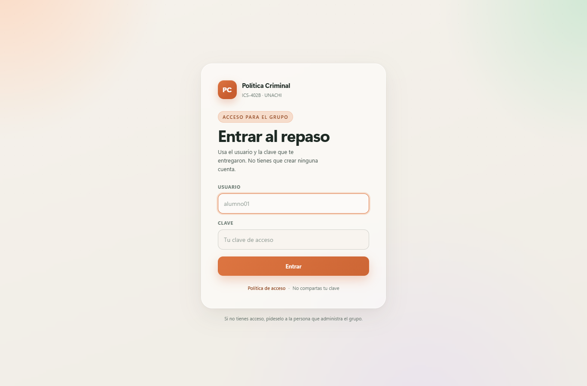
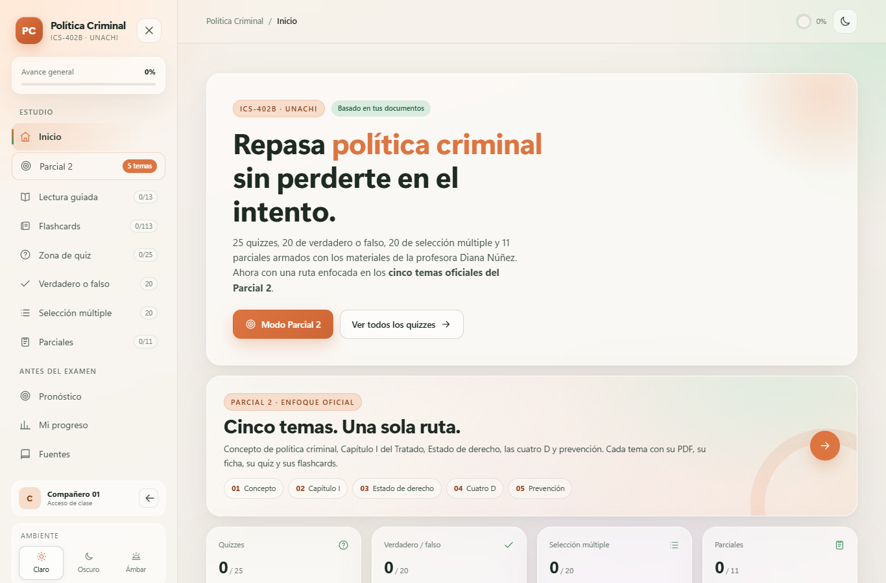

# Política Criminal · ICS-402B · Grupo

Versión de repaso para el grupo de **Política Criminal (ICS-402B, UNACHI)**. Es el mismo contenido de estudio, con una pantalla de acceso para que el enlace no quede abierto a cualquier persona.

**Sitio:** https://magdalenagonzalez08.github.io/politica-criminal-ics402b-clase/

[](https://magdalenagonzalez08.github.io/politica-criminal-ics402b-clase/)

## Acceso

- Hay **10 usuarios** de la aplicación, creados por la administradora. No hay registro público.
- Cada compañero recibe un usuario y una clave por un canal privado.
- La sesión dura **8 horas** y se cierra al cerrar el navegador.
- Después de **5 intentos fallidos**, el usuario se bloquea durante **5 minutos**.
- El botón **Salir** está en la parte inferior del menú lateral.
- No compartas tu usuario, tu clave ni capturas con la sesión abierta.

Las claves se entregan en un archivo local que **no se sube al repositorio**. La página solo guarda sales y hashes PBKDF2-SHA-256.

## Contenido

| Sección | Contenido |
| --- | --- |
| Parcial 2 | Cinco temas, fichas, casos y plan de 60 minutos |
| Lectura guiada | 13 capítulos con ideas clave, artículos, cifras y fuentes |
| Flashcards | 11 mazos y 113 tarjetas |
| Zona de quiz | 25 quizzes de 5 preguntas |
| Verdadero o falso | 20 afirmaciones |
| Selección múltiple | 20 preguntas |
| Parciales | 10 simulacros de 10 preguntas y un parcial oficial de 20, con cronómetro |
| Pronóstico | Los cinco temas del Parcial 2 |
| Mi progreso | Resultados guardados en el navegador |

En total, **285 preguntas** y **113 tarjetas** de estudio.

### Vista del repaso



## Seguridad

Esta versión usa un **control de acceso básico**, no autenticación de nivel profesional:

- No se guardan claves en texto plano en el sitio.
- La sesión se guarda en `sessionStorage`.
- Hay bloqueo temporal después de varios intentos.
- La página de política de acceso está en [`seguridad.html`](seguridad.html).
- Las reglas del repositorio están en [`SECURITY.md`](SECURITY.md).

GitHub Pages es un sitio estático. Una persona con conocimientos técnicos podría inspeccionar los archivos públicos, así que este acceso sirve como filtro para el grupo, no para datos sensibles ni cobros.

## Tecnología

HTML, CSS y JavaScript sin dependencias ni servidor. Funciona desde GitHub Pages y desde un servidor local.

```
index.html
login.html
seguridad.html
estilos.css
login.css
app.js
acceso.js
login.js
usuarios.js
robots.txt
datos-quizzes.js
datos-vf-mc.js
datos-parciales.js
datos-estudio.js
datos-parcial2.js
datos-parcial2-practica.js
```

## Nota

Material de estudio elaborado a partir de la planificación y los documentos de la asignatura. Es una herramienta de repaso, no una publicación oficial de la universidad.
